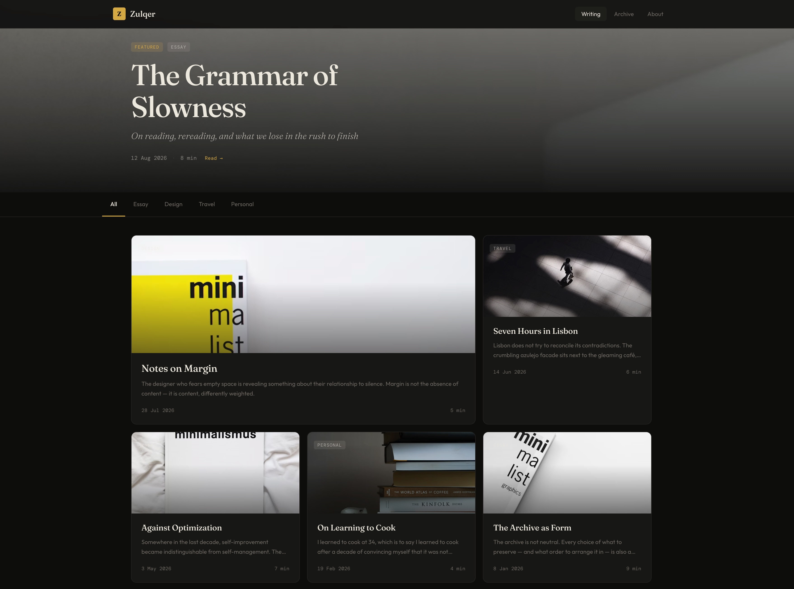

# Zulqer

Zulqer is an editorial theme for Zola 0.23 and later with persistent dark and light modes. It is designed for long-form writing and technical notes, with responsive article cards, build-time code highlighting, archive and taxonomy pages, search, reading progress, code copy buttons, and an image lightbox.



## Install

```sh
git clone https://github.com/menzil/zulqer.git themes/zulqer
```

Set the theme in the site configuration:

```toml
theme = "zulqer"

[markdown.highlighting]
theme = "catppuccin-mocha"
```

The complete configuration surface and translated labels are listed in [config.toml](config.toml). Site-specific values override the defaults under `[extra.zulqer]`.

## Article Images

Markdown images inside article content open in a keyboard-accessible lightbox. An optional cover can be set per article:

```toml
[extra]
cover = "/images/article-cover.jpg"
```

## Author

Zulqer is designed and maintained by Ruzaji Yasin.

Repository: [github.com/menzil/zulqer](https://github.com/menzil/zulqer)

Online demo: [orhan.cn](https://orhan.cn/)
